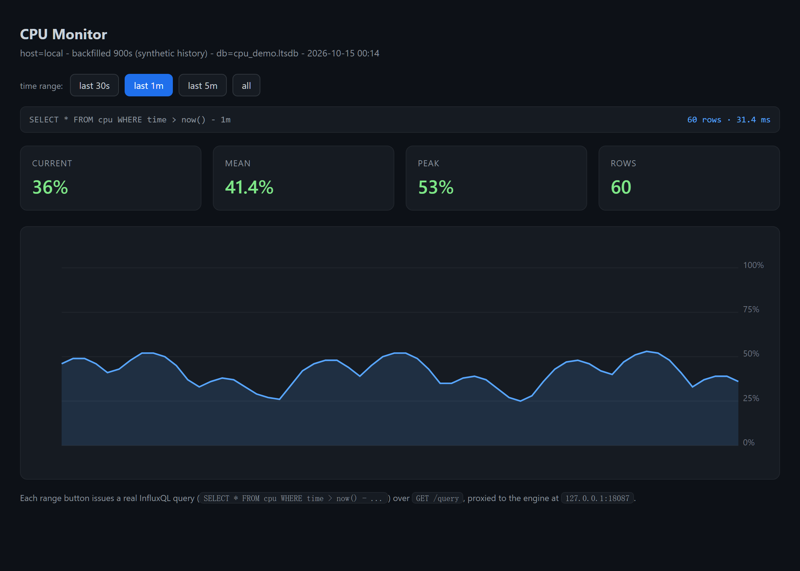
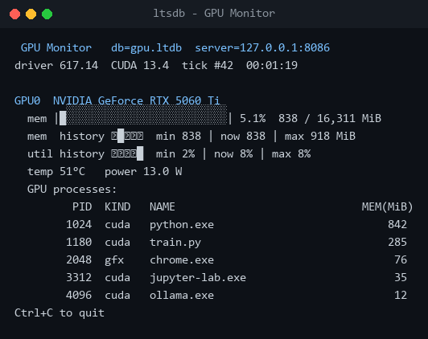
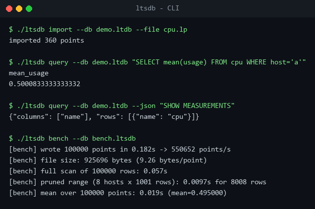
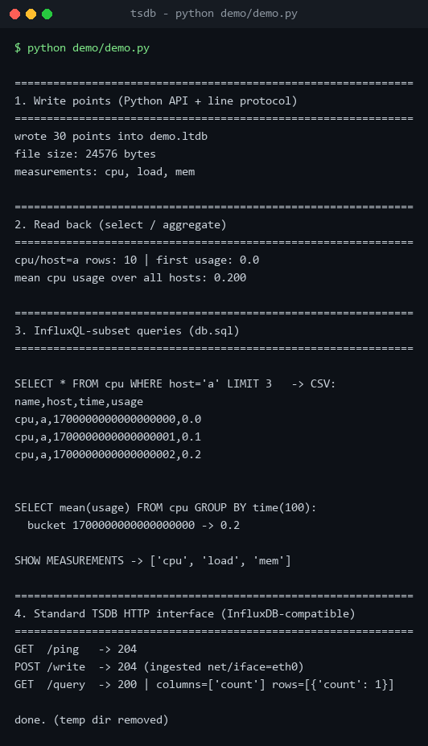

# local-tsdb

[English](README.md) · **简体中文**

一个**单文件、零依赖的时序数据库**，对外提供**兼容 InfluxDB** 的写入与查询接口。

`local-tsdb` 把时序库通常需要一整条链路才能提供的东西——页式存储引擎、预写日志（WAL）、
Gorilla 压缩、标签倒排索引，以及 InfluxQL 的一个子集——打包进**一个文件**和**一个静态二进制**，
思路类似 SQLite。

```
┌──────────────────────────────────────────────────────────────┐
│  HTTP API  /ping  /health  /write  /query     CLI: ltsdb      │
├──────────────────────────────────────────────────────────────┤
│  Line protocol (write)        InfluxQL subset (query)         │
├──────────────────────────────────────────────────────────────┤
│  Query engine: series match → block time-pruning → project/agg│
├──────────────────────────────────────────────────────────────┤
│  Index  ·  Columnar data blocks (Gorilla)  ·  Page store + WAL│
│                     one database file                         │
└──────────────────────────────────────────────────────────────┘
```

[](LICENSE)


---

## 初衷

两个我一直感兴趣的方向在这里碰上了：

- **AI/ML workload 本身就是时序 workload。** 每次训练或推理都会产出 loss、tokens/s、
  GPU 利用率、显存、功耗、延迟这些指标。很多时候只想把它们存成运行目录旁边的文件，
  而不是拉一整套指标服务。
- **一直对存储引擎感兴趣**——SQLite 如何把库塞进一个分页单文件、InfluxDB 的 TSM block
  与 Gorilla 压缩怎么工作、预写日志如何保证崩溃安全。

## Demo

一个 CPU 监控看板，数据来自**真实采集**
（[`python/examples/cpu_dashboard.py`](python/examples/cpu_dashboard.py)）：负载经 `/write`
写入 `ltsdb`，时间范围按钮会发起真实的、带时间条件的 InfluxQL 查询。



GPU 监控 demo 与 Go CLI：





## 仓库内容

| 路径 | 语言 | 作用 |
|---|---|---|
| [`cmd/`](cmd)、[`internal/`](internal)、[`ltsdb.go`](ltsdb.go) | Go 1.21，仅标准库 | **生产引擎** —— `ltsdb` 二进制：引擎、InfluxQL、HTTP API、CLI（这里是 Go 模块根，故 `go get` 可用） |
| [`python/tsdb/`](python/tsdb) | Python 3，仅标准库 | **参考实现** —— 同样的架构，便于阅读与审计 |
| [`python/gpu_monitor/`](python/gpu_monitor) | Python + `pynvml` | **真实场景 demo** —— 采集 GPU → `/write` → 实时 ANSI 看板 |
| [`python/examples/`](python/examples) | Python 3 | 可运行示例：引擎端到端演示与 CPU 看板 |
| [`DESIGN.md`](DESIGN.md) | — | 架构与磁盘格式说明（参考实现） |
| [`docs/`](docs) | — | README 截图与终端渲染脚本 |

两套引擎共享同一套设计与磁盘思路；Go 版是你实际运行的，Python 版是你对照阅读的规格说明。

## 特性

- **单文件存储** —— 一个数据库文件 + 可选的 `.wal`；含头部页、用于页复用的 freelist、
  overflow blob 链，以及"先恢复再 checkpoint"的 WAL（崩溃安全、可容忍撕裂帧）。
- **InfluxDB 数据模型** —— `measurement + tags + fields + timestamp`，纳秒时间戳，
  规范化 series key，逐字段类型（`i`/`f`/`b`/`s`）。
- **列式压缩** —— gauge 用 Gorilla float XOR，时间戳与整型计数器用 delta-of-delta，
  另配 zigzag varint。
- **时间边界裁剪** —— 每个 block 携带 `(locator, min_ts, max_ts)`；
  查询直接跳过窗口外的整块，而不解码。
- **兼容 InfluxDB 接口** —— line protocol 写入，`GET|POST /query` 返回 CSV 或 JSON，
  另有 `/ping`、`/health`。
- **InfluxQL 子集** —— `SELECT` 与聚合（`count|sum|mean|min|max`）、
  时间与标签的 `WHERE`、`GROUP BY time(...)`/标签、`LIMIT`、`SHOW MEASUREMENTS`。
- **零第三方依赖** —— 仅用 Go 标准库；Python 引擎同样（只有 GPU demo 需要 `pynvml`）。

## 快速开始

### 1. Go 引擎（实际使用的那个）

```sh
go build -o ltsdb ./cmd/ltsdb          # Windows 上加 .exe

# 启动兼容 InfluxDB 的 HTTP 服务
./ltsdb serve --db metrics.ltsdb --addr 127.0.0.1:8086
```

通过 HTTP 写入与查询：

```sh
curl -i -XPOST 'http://127.0.0.1:8086/write?precision=s' \
  --data-binary 'cpu,host=a,region=us usage=0.64'

curl -G 'http://127.0.0.1:8086/query' \
  --data-urlencode 'q=SELECT mean(usage) FROM cpu WHERE host='"'"'a'"'"''

# 返回 JSON 而非 CSV
curl -G 'http://127.0.0.1:8086/query' -H 'Accept: application/json' \
  --data-urlencode 'q=SHOW MEASUREMENTS'
```

CLI 子命令：

```sh
ltsdb serve   --db PATH [--addr 127.0.0.1:8086]
ltsdb query   --db PATH [--json] ("<SQL>" | --file Q.sql)   # CSV/JSON 输出到 stdout
ltsdb exec    --db PATH ("<SQL>" | --file Q.sql)            # 行数输出到 stderr
ltsdb import  --db PATH (--file lines.lp | -) [--precision ns|s|m|u] [--commit-every N]
ltsdb bench   --db PATH [--points 100000] [--hosts 8]
```

退出码：`0` 成功，`1` 用法/语法错误，`2` 运行时错误。

### 2. Python 参考引擎

```sh
python python/examples/demo.py          # 端到端：API + line protocol + InfluxQL + HTTP
cd python && python -m pytest -q        # 139 个测试
```

```python
from tsdb import TimeSeriesDB, Point

with TimeSeriesDB("cpu.ltdb") as db:
    db.write([Point("cpu", {"host": "a"}, {"usage": 0.67}, 1_700_000_000_000)])
    db.commit()
    rows = db.select(measurement="cpu", tag_filters={"host": "a"})
```



### 3. GPU 监控 demo（Windows）

复用或自动拉起 `ltsdb serve`，把 GPU 利用率/显存/温度/功耗以及逐进程显存写入数据库，
再根据 `/query` 结果渲染一个实时 ANSI 看板：

```sh
pip install -r python/requirements.txt
cd python && python -m gpu_monitor --db ../gpu.ltdb --interval 1
```

Windows（WDDM）下逐进程显存来自一个常驻的 PowerShell `Get-Counter` 子进程，
因为当前驱动下 NVML 并不暴露该数据。

## 作为包安装

### Go 库 / CLI

```sh
go get github.com/Kelmory/local-tsdb        # 作为库
go install github.com/Kelmory/local-tsdb/cmd/ltsdb@latest   # 作为 CLI
```

```go
import ltsdb "github.com/Kelmory/local-tsdb"

db, _ := ltsdb.Open("metrics.ltsdb")
defer db.Close()

db.WritePoints([]ltsdb.Point{{
    Measurement: "cpu",
    Tags:        map[string]string{"host": "a"},
    Fields:      map[string]any{"usage": 0.64},
}})
db.Commit()

rows, _ := db.Select(context.Background(), ltsdb.SelectQuery{Measurement: "cpu"})
rs, _ := ltsdb.Exec(db, "SELECT mean(usage) FROM cpu")   // InfluxQL -> ResultSet
```

### Python 包

```sh
pip install ./python            # 从克隆的仓库安装
pip install local-tsdb          # 发布到 PyPI 之后
pip install "local-tsdb[gpu]"   # 额外拉取 pynvml，用于 GPU 监控 demo
```

GPU 监控以控制台脚本形式安装：`local-tsdb-gpu --db gpu.ltdb`。

## 基准测试

负载：8 个 series 共 100 000 个点，经 line protocol 写入。

| 指标 | Python 参考实现 | Go 引擎 |
|---|---:|---:|
| 写入吞吐 | ~44k pts/s | **~549k pts/s** |
| 文件大小 | 8.60 B/point | **9.26 B/point** |
| 全表扫描（10 万行） | ~1.12 s | **0.060 s** |
| 裁剪查询（8008 行） | ~32 ms | **5.0 ms** |
| 10 万点的 `mean` | ~0.99 s | **0.015 s** |

可用 `ltsdb bench --db tmp.ltsdb` 复现（数字随机器不同而有差异）。

## 借鉴来源与诚实定位

本项目**不发明新算法**。它是一份干净实现，组合了公开且成熟的设计，且**大部分代码由本地 Bonsai Qwen 模型编写并验证**：

- SQLite 的单文件页模型、freelist 与预写日志；
- InfluxDB 的存储模型、TSM 式按时间边界裁剪的列式 block，以及
  Gorilla float-XOR / delta-of-delta 编码；
- InfluxDB line protocol 与 InfluxQL 作为对外接口。

这里真正的价值在于**打包方式**——一个小巧、可读、单文件、嵌入式、且与 InfluxDB 接口兼容的
时序引擎——而不是新的研究成果。

## 已知限制

- **单写者** —— 仅进程内一把锁，无跨进程文件锁；不是多客户端服务。
- **block 只增不改** —— 每次 commit 都会为被写入的 series 开新 block，暂无 compaction，
  因此高频 commit 会让文件持续增长。
- **无保留策略 / 降采样 / 连续查询** —— 时间裁剪只到 block 级。
- **聚合为内存折叠** —— 没有物化的部分聚合结果。
- **InfluxQL 是子集** —— 不支持子查询、正则、多 measurement join。

## 路线图

- [ ] block compaction / 合并
- [ ] 保留策略与 rollup
- [ ] demo 的跨平台 GPU 后端
- [ ] macOS / Windows 上的 CI 与基准测试
- [ ] 更完整的 InfluxQL（正则、无聚合的 `GROUP BY`）

## 许可证

[MIT](LICENSE)。
